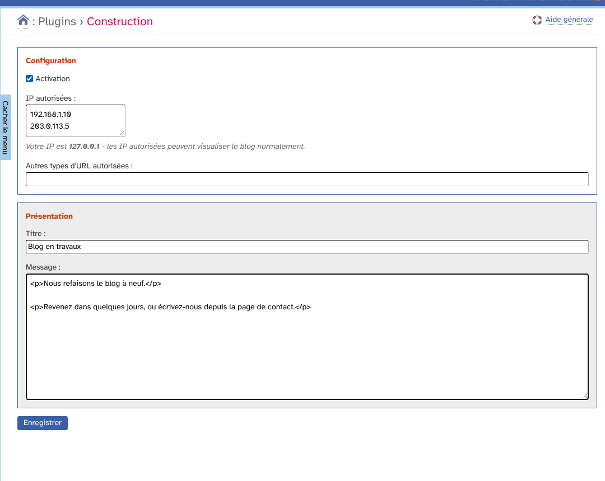
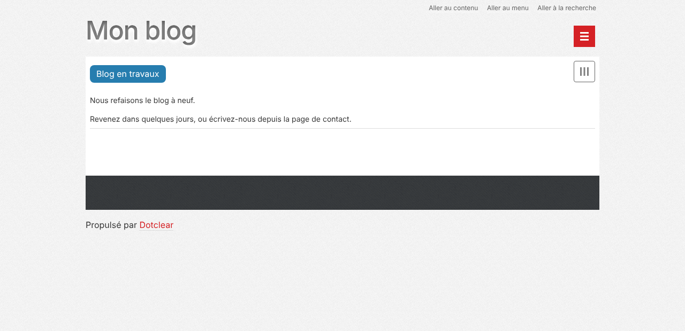

# construction : guide d'utilisation

construction met la partie publique de votre blog en mode « travaux ».
Vos visiteurs voient un message de votre choix à la place du blog.
Vous, et les personnes dont vous donnez l'adresse IP, voient le blog normalement.

## Sommaire

* [Ouvrir la page du plugin](#ouvrir-la-page-du-plugin)
* [Activer le mode construction](#activer-le-mode-construction)
* [Choisir qui voit le blog](#choisir-qui-voit-le-blog)
* [Garder certaines pages accessibles](#garder-certaines-pages-accessibles)
* [Écrire le message](#écrire-le-message)
* [Ce que voient les visiteurs](#ce-que-voient-les-visiteurs)
* [Sortir du mode construction](#sortir-du-mode-construction)

## Ouvrir la page du plugin

Dans le menu « Plugins », cliquez sur « Construction ».
Tous les réglages sont sur cette page.

## Activer le mode construction

Cochez la case « Activation », puis cliquez sur « Enregistrer ».

Le mode est actif tout de suite.
L'administration du blog n'est pas touchée : vous pouvez continuer à y travailler.

## Choisir qui voit le blog

Le champ « IP autorisées » liste les adresses IP qui voient le blog normalement.

* Écrivez une adresse par ligne.
* Votre propre adresse est affichée sous le champ : ajoutez-la pour vérifier votre blog pendant les travaux.
* Une adresse écrite sur la même ligne qu'une autre, séparée par une virgule, n'est pas reconnue.

Toute autre personne voit la page de construction.

## Garder certaines pages accessibles

Le champ « Autres types d'URL autorisées » liste les types de pages publiques qui restent ouverts à tous.
Séparez-les par des virgules.

Par exemple, écrivez `feed` pour que les flux de syndication restent disponibles.
La page de contact reste toujours accessible.

## Écrire le message

Le bloc « Présentation » contient la page vue par les visiteurs :

* **Titre** : le titre de la page ;
* **Message** : le texte, en HTML. Utilisez les balises `
` pour les paragraphes.

## Ce que voient les visiteurs

Un visiteur qui n'est pas autorisé voit votre titre et votre message, quelle que soit la page demandée.

La page est envoyée avec le code « 503 Service Unavailable » : les moteurs de recherche comprennent que l'arrêt est temporaire.
Le plugin fournit des modèles pour les thèmes Dotty et Mustek.

## Sortir du mode construction

Décochez « Activation » et enregistrez.
Le blog redevient visible pour tout le monde.
Vos réglages sont conservés pour la prochaine fois.
